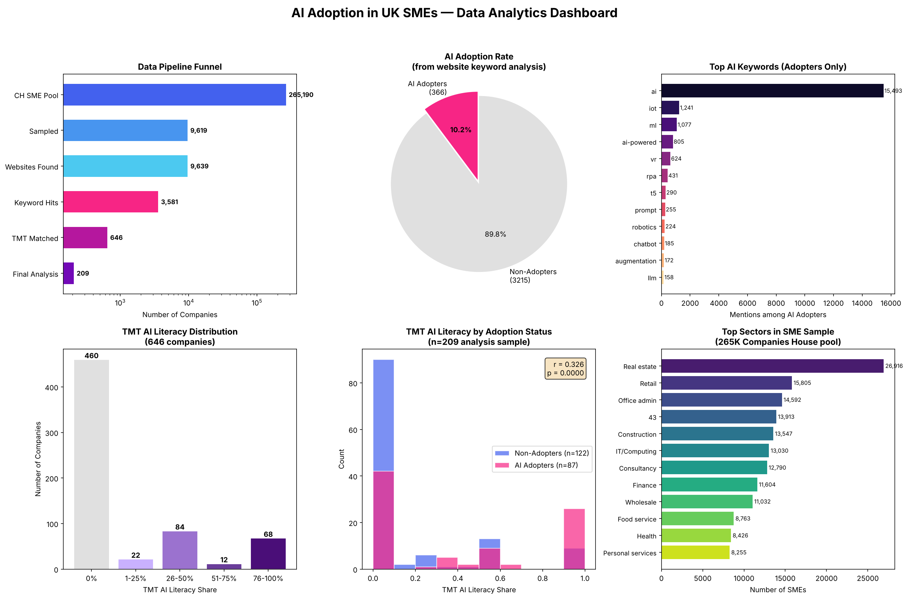
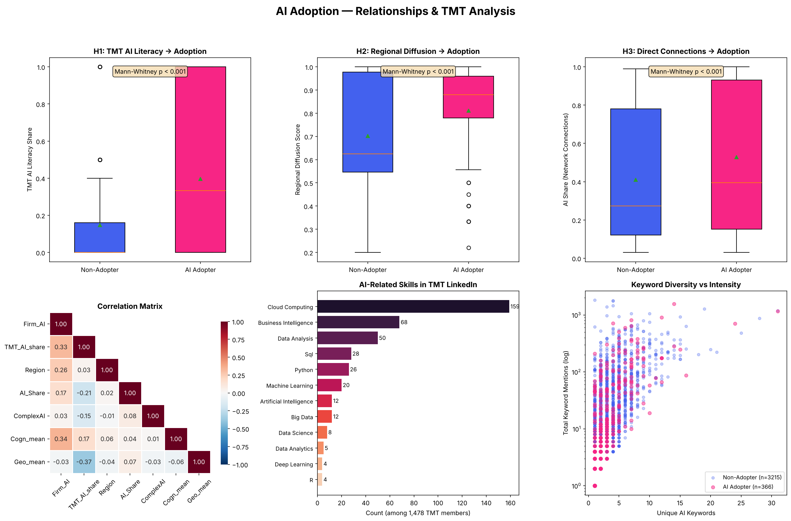

# AI Adoption in UK SMEs — Determinants & Analysis

A data-driven study of AI adoption among UK small and medium enterprises, grounded in
Upper Echelons Theory and Social Capital Theory.

**Author:** Sarthaj Aram Kuni
**Programme:** MSc Information Systems & Digital Innovation, Loughborough University

---

## Research Questions

- **RQ1:** How does Top Management Team (TMT) AI literacy affect firm-level AI adoption in UK SMEs?
- **RQ2:** How does knowledge spillover (regional diffusion, direct inter-firm connections) moderate that relationship?

## Data Pipeline

The study starts from the full Companies House SME register and narrows through sampling,
web scraping, and TMT profile matching:

```
265,190  UK SMEs (Companies House)
  9,619  Sampled with resolved websites
  3,581  With keyword-matched website text
    646  With TMT AI literacy data
    209  Complete cases for regression
```



---

## Key Variables

| Variable | Description | Source |
|---|---|---|
| `Firm_AI` | Binary: firm mentions AI keywords on its website | Web scraping + keyword dictionary (65 terms) |
| `TMT_AI_share` | Proportion of officers with AI-related skills | LinkedIn profile coding |
| `Region` | Regional AI diffusion index (ITL-3 level) | ONS geography + neighbourhood adoption rates |
| `AI_Share` | Share of directly connected firms that adopted AI | Hyperlink network analysis |
| `Cogn_mean` | Cognitive proximity to AI-adopting firms | Sentence-embedding cosine similarity |
| `Geo_mean` | Geographic proximity to AI-adopting firms | Haversine distance (inverse) |
| `ComplexAI` | Binary: complex vs simple AI usage | Paragraph classifier |

---

## Results

### Adoption Rate

Of 3,581 companies with keyword data, **366 (10.2%)** are classified as AI adopters.
In the 209-observation analysis sample (after TMT matching), the adoption rate is **41.6% (87 firms)**,
reflecting that companies with available TMT data skew toward larger, more digitally active firms.

### Hypothesis Tests (Mann-Whitney U)

| Variable | Non-Adopter Mean | Adopter Mean | U | p-value | Verdict |
|---|---|---|---|---|---|
| TMT_AI_share | 0.147 | 0.397 | 3,700 | <0.001 | Significant |
| Region | 0.703 | 0.811 | 3,973 | 0.002 | Significant |
| AI_Share | 0.410 | 0.528 | 4,130 | 0.006 | Significant |
| Cogn_mean | 0.372 | 0.573 | 3,567 | <0.001 | Significant |
| Geo_mean | 0.830 | 0.819 | 5,447 | 0.746 | Not significant |
| ComplexAI | 0.630 | 0.652 | 4,905 | 0.350 | Not significant |

### Logistic Regression Models

| Predictor | Model 1 (TMT only) | Model 2 (Full) | Model 3 (Interaction) |
|---|---|---|---|
| TMT_AI_share | 1.815*** | 2.802*** | -2.966 |
| ComplexAI | — | 0.591 | — |
| AI_Share | — | 1.705*** | 2.068*** |
| Region | — | 3.333*** | 1.522 |
| Cogn_mean | — | 2.453*** | 2.267*** |
| Geo_mean | — | 2.006* | 1.985* |
| TMT × Region | — | — | 7.949** |
| | | | |
| Pseudo R² | 0.079 | 0.262 | 0.289 |
| AIC | 265.5 | 223.4 | 215.8 |
| N | 209 | 209 | 209 |

\* p < 0.05, \*\* p < 0.01, \*\*\* p < 0.001

### Hypothesis Outcomes

- **H1 Supported.** TMT AI literacy is the strongest predictor of firm AI adoption (Model 2: β = 2.80, p < 0.001).
  Companies with higher proportions of AI-literate officers are significantly more likely to adopt AI.

- **H2 Supported.** Regional AI diffusion significantly predicts adoption (β = 3.33, p < 0.001)
  and positively moderates the TMT-adoption link (TMT × Region interaction: β = 7.95, p = 0.006).
  TMT AI literacy matters more in regions with higher existing AI diffusion.

- **H3 Supported.** Direct inter-firm connections to AI adopters predict adoption (β = 1.71, p < 0.001),
  consistent with knowledge spillover through firm networks.

- **ComplexAI not significant** (β = 0.59, p = 0.230) — the distinction between simple and complex
  AI use does not predict adoption in this sample.



---

## Repository Structure

```
├── README.md
├── requirements.txt
├── data/
│   └── processed/               ← cleaned, analysis-ready datasets
│       ├── company_ai_adoption.csv    (3,581 companies)
│       ├── tmt_ai_literacy.csv        (646 companies)
│       ├── keyword_frequency.csv      (65 keywords)
│       ├── analysis_dataset.csv       (209 observations)
│       ├── sample_websites.csv        (9,639 sampled firms)
│       └── tmt_linkedin_summary.csv   (1,478 profiles)
├── results/
│   ├── figures/
│   │   ├── dashboard_main.png
│   │   └── dashboard_relationships.png
│   └── regression_results.json
└── notebooks/
    └── 01_data_analytics.ipynb  ← full analysis notebook
```

## Processed Data

| File | Rows | Description |
|---|---|---|
| `company_ai_adoption.csv` | 3,581 | Company-level AI adoption flags with keyword counts |
| `tmt_ai_literacy.csv` | 646 | TMT AI literacy share per company |
| `keyword_frequency.csv` | 65 | Keyword frequency table with adopter share |
| `analysis_dataset.csv` | 209 | Final regression dataset (all variables merged) |
| `sample_websites.csv` | 9,639 | Sampled companies with resolved websites |
| `tmt_linkedin_summary.csv` | 1,478 | Structured LinkedIn profile summary (skills, experience, education) |

---

## Limitations & Next Steps

- **Sample attrition:** 209 complete cases from 9,619 sampled firms. V2 pipeline plans MICE
  multiple imputation to recover n ≥ 600 and reduce selection bias.
- **Cross-sectional design:** cannot establish causality. A wave-2 collection (2026) would
  enable change-score models.
- **Keyword-based classification:** may miss firms using AI without mentioning it publicly.
  Future work: zero-shot LLM labelling with human audit.
- **Firth penalized logit** planned for robustness against small-sample bias and quasi-separation.

---

## Acknowledgements

Dissertation supervised by Ahmad Asadullah, Loughborough University.
